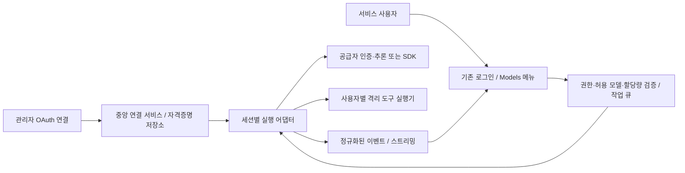

# 관리자 OAuth 연결 계정의 다중 사용자 실행 검토

검토일: 2026-10-21. 설계 검토이며 현재 실행 코드는 API 키 연결을 유지한다.

## 결론

관리자가 공급자에 OAuth 로그인하고 서비스 사용자는 별도의 공급자 로그인 없이 요청하는 구조는
기술적으로 구성할 수 있다. 그러나 관리자 개인 구독을 여러 사람이 사용하는 권한이 자동으로
생기는 것은 아니다. 공식 SDK 구독 인증 지원과 다중 사용자 계정 공유 허용은 구분해야 한다.

실서비스 도입 조건은 해당 조직 계정·계약에 이 사용 방식이 허용되는지 공급자 확인이다.
팀 구독을 구매했다는 사실만으로 단일 사용자 OAuth grant가 조직 전체 실행 자격증명이 되지는 않는다.
지원되지 않는 개인 구독을 중앙 API로 재포장하는 방식은 운영안으로 채택하지 않는다.

## 공식 근거와 해석

| 대상 | 확인 사실 | 이 프로젝트에 대한 판단 |
|---|---|---|
| OpenAI 개인용 약관 | 계정 자격증명 공유 및 다른 사람에게 계정 제공을 제한 | 관리자 개인 계정의 다중 사용자 실행을 허용한다고 볼 근거가 없음 |
| ChatGPT plan usage | 사용자·워크스페이스 단위 클라이언트와 호스트, 원격 앱 별도 문의 안내 | 중앙 호스팅·공유 grant의 지원 범위를 확인해야 함 |
| Anthropic 개인용 약관 | 계정 로그인 정보·자격증명 공유 및 다른 사람에게 계정 제공을 제한 | 토큰을 서버에만 두는 기술적 조치가 이용 권한 문제를 해결하지 않음 |
| Claude Agent SDK 구독 안내 | SDK, claude -p 등의 구독 사용 지원을 설명 | SDK 사용 가능의 근거이며 여러 사용자가 한 구독을 공유할 권한의 근거는 아님 |

이는 공개 문서에 기반한 적용 판단이다. 개별 기업 계약·승인 여부는 확인하지 않았다.

- [OpenAI Terms of Use — Registration and access](https://openai.com/policies/terms-of-use/)
- [ChatGPT plan usage](https://developers.openai.com/siwc/token-sharing-open-source)
- [Anthropic Consumer Terms — Account creation and access](https://www.anthropic.com/legal/consumer-terms)
- [Claude Agent SDK 구독 안내](https://support.claude.com/en/articles/15036540-use-the-claude-agent-sdk-with-your-claude-plan)
- [Codex app-server 연결](https://developers.openai.com/siwc/token-sharing-open-source/codex-app-server)

## 지원 계정이 확보된 경우의 구성안

사용자가 공유하는 것은 공급자 연결과 그 한도다. 대화 기록·작업 파일·도구 권한·세션은 공유하지 않는다.
자격증명은 연결 서비스의 신뢰 경계 안에만 보관하며 사용자 브라우저·터미널·컨테이너에 반환하지 않는다.

### 관리자 기능

- 공식 인증 경로의 OAuth 연결 시작, 완료·실패 상태, 재인증·연결 해제.
- 연결 ID, 공급자, 인증 계정·워크스페이스의 최소 식별 정보 표시.
- 실제 사용 가능한 모델과 관리자 허용 목록의 교집합만 사용자에게 노출.
- 사용자·향후 Team별 연결 사용 권한, 연결별 동시 실행 한도, 사용자별 요청·토큰 한도.
- 만료·권한 철회·공유 한도 소진 표시와 신규 요청 접수 중단.

### 사용자 동작

기존 서비스 ID/PW 로그인 → 관리자 허용 모델 선택 → 사용자별 새 세션 실행.
공급자 로그인이나 공급자 자격증명 입력은 요구하지 않는다.
오류 화면은 재로그인·재인증을 사용자에게 떠넘기지 않고 관리자 연결 문제임을 안내한다.

## Hermes 유지와 SDK 실행은 다른 구현 경로

| 경로 | 동작 | 영향 |
|---|---|---|
| Hermes agent 유지 | 지원되는 OAuth 추론 grant를 공급자별 프로토콜 어댑터가 사용. 도구 실행과 대화 루프는 Hermes가 소유 | 현재 구조에 더 가까움. 공식 inference endpoint·권한·Messages/Responses 계약 검증 필요 |
| Claude Agent SDK / Codex app-server | 각 엔진이 대화·도구 루프를 소유하고 서비스가 세션과 이벤트를 중계 | 별도 실행 엔진 추가에 해당. 단순 Chat Completions 변환 프록시로 취급하면 안 됨 |

SDK를 Hermes의 한 모델 호출처럼 요청마다 새로 실행하면 중첩 agent 루프, 중복 도구 실행,
세션 유실, 사용량 중복 집계가 발생할 수 있다. 먼저 모델 공급자 확장인지 실행 엔진 확장인지 결정한다.

요청한 사용자 경험은 두 경로 모두 설계할 수 있지만 SDK 기능·인증·운영 승인은 실증 전이다.
일반 OpenAI/Anthropic API SDK에 개인 구독 OAuth 토큰을 넣는 것만으로 동일하게 동작한다고 가정하지 않는다.

## 격리와 운영 필수 조건

1. 연결별 토큰 저장과 갱신은 중앙 단일 소유자로 관리한다. refresh 회전은 DB 잠금으로 직렬화하고,
   만료 grant는 재시도 폭주 대신 재인증 필요 상태로 전환한다. SDK 자체 credential store를 쓴다면
   SDK가 갱신의 유일한 소유자가 되도록 하며 중앙 서비스와 이중 갱신하지 않는다.
2. 작업에는 connection_id, user_id, space_id, session_id를 서버가 결합한다. 클라이언트가 공급자
   세션 ID나 다른 사용자의 작업 경로를 임의 지정할 수 없게 한다. SDK resume ID도 이 매핑으로 검증한다.
3. 하나의 OAuth 연결을 쓰더라도 사용자별 대화·cwd·파일 저장소는 분리한다. 전체 사용자에게 하나의
   SDK thread, 대화 메모리, Claude/Codex 작업 디렉터리를 재사용하지 않는다.
4. 공급자 자격증명과 임의 코드 실행을 같은 신뢰 경계에 두지 않는다. 공유 SDK worker에 Bash·파일 도구를
   무제한 허용하면 사용자가 credential 파일이나 프로세스 환경을 읽을 수 있다. built-in 도구 권한을
   제한하고 사용자 도구 실행은 별도 격리 실행기로 전달하는 연결을 검증해야 한다.
5. 연결 단위 동시 실행 제한·공정 큐·대기 만료·취소를 도입한다. 초기 검증은 연결당 한 작업으로 시작하되
   이 제한이 공급자 허용량이나 공유 이용 권한을 보증한다고 표현하지 않는다.
6. 사용자 quota와 연결 전체 quota를 별도로 집계한다. 공급자가 usage를 제공하지 않는 경우 비용이나
   잔여 구독량을 추정값으로 표시하며, 현재 토큰 예약량을 실제 공급자 청구량처럼 취급하지 않는다.
7. 연결 해제 시 신규 접수 차단, queued 작업 취소, 실행 작업 종료 정책, SDK credential 폐기·공급자
   철회 여부를 구분한다. 한 사용자의 취소가 다른 사용자의 작업을 종료하지 않게 한다.
8. API 키로의 자동 fallback은 사용자가 모르는 비용을 만들 수 있으므로 기본 금지한다. 필요하면
   관리자가 연결별로 명시적으로 설정하고 UI에 현재 인증·과금 경로를 표시한다.

## 현재 프로젝트 변경 범위

- 현재 `model_providers`의 공급자당 단일 API 키 구조와 별개로 `provider_connections`를 설계한다.
  필드: 공급자, auth_method, enabled, grant 상태, workspace, token 저장 참조, 버전, 만료,
  갱신 소유 방식, 동시 실행 정책. OAuth 원문은 암호화하며 API 응답에 포함하지 않는다.
- 모델 정책은 model ID만이 아니라 connection_id와 provider model ID의 조합으로 식별한다.
  동일 모델이 여러 계정에 있을 때 임의로 다른 계정으로 라우팅하지 않는다.
- 현재 `/v1/chat/completions`는 API 키용으로 유지한다. OAuth inference 어댑터 또는 SDK 실행 경로를
  별도로 추가하고 실제 지원 계약을 통과한 경로만 활성화한다.
- `ModelCall`의 user quota 외에 연결 단위 작업 큐·상태·중단·재개 매핑을 추가한다.
- Models 목록과 선택·실행 검증은 동일 정책으로 유지한다. 기존 사용자·Team 공유 설계와도 분리한다.
- Compose에 중앙 인증/실행 worker를 추가한다. AWS에서는 조직 credential 보관·실행 격리·작업 큐에 맞춰
  Secrets Manager/KMS와 worker 운영을 설계하며, SDK별 저장 파일 호환성은 별도 검증한다.

## 적용 전 확인할 항목과 완료 기준

공급자 확인: 실제 계정 플랜·계약, 내부 직원/외부 사용자 구분, 예상 사용자 수·동시 실행,
단일 grant의 대리 실행·호스팅 허용 여부, 승인된 OAuth client·callback·scope·호스트 조건.

기술 검증: 관리자 연결·재인증·해제, 두 사용자의 동일 연결 실행, 파일/대화/resume 격리,
금지 모델 거부, 토큰 갱신 경쟁, 한도 소진, 취소 격리, 서버 재시작 후 복구, 실제 tool call·stream·usage,
사용자 도구를 통한 credential 접근 차단을 모두 확인한다. 가짜 토큰·mock 테스트는 실제 grant 검증과 구분한다.

이번 검토에서는 OAuth 연결, 실제 SDK 실행, 계정 공유 활성화 또는 운영 설정 변경을 수행하지 않았다.
