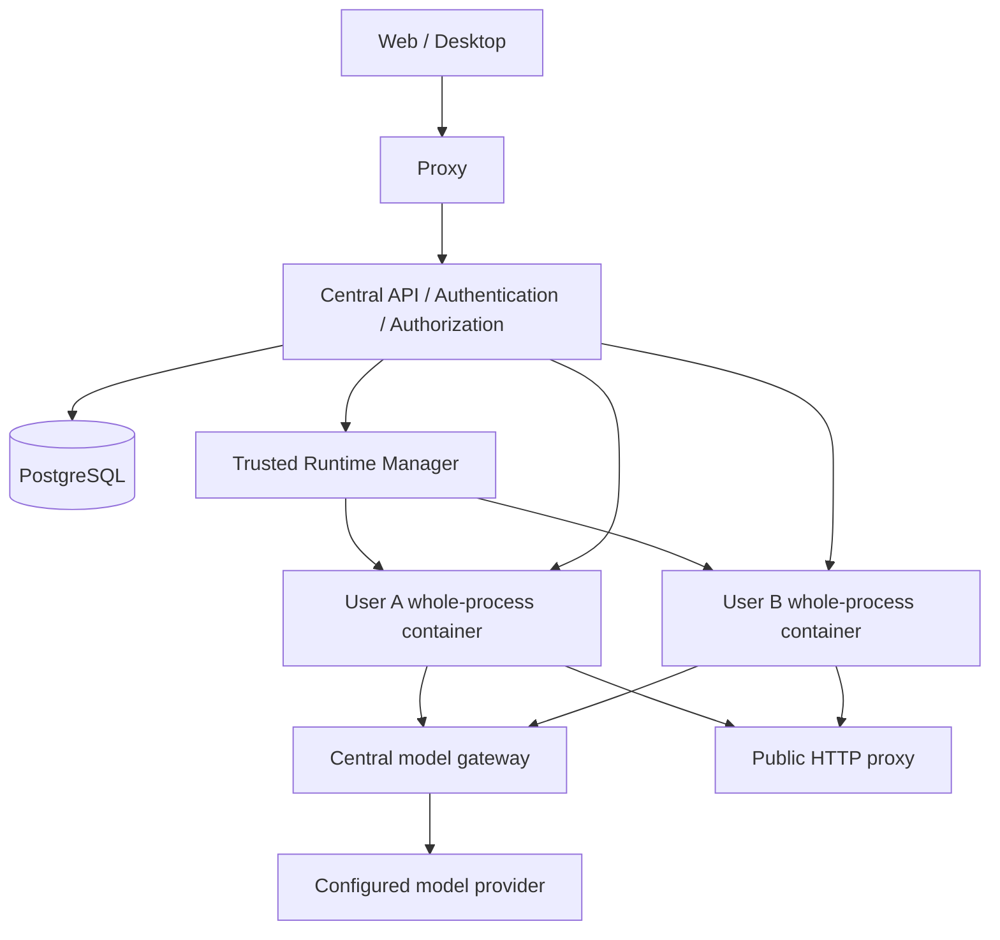

# 중앙 서비스 아키텍처와 확장 계약

## 구현 경계

이 저장소는 upstream Hermes 코어를 수정하지 않는 독립 서비스다. 최초 버전은 로컬 Docker Compose, 개인 ID/PW 가입·승인, 개인 런타임, 중앙 모델 게이트웨이를 구현한다. Team·SSO·소셜·AWS Terraform은 아래 계약으로 설계하며 활성 기능으로 표시하지 않는다.

Compose의 정적 서비스와 Manager의 동적 런타임은 다른 수명주기다. 사용자 수가 늘어도 Compose YAML을 수정하지 않는다. Manager는 service-owned label과 UUID 이름을 검증하고, 고정 이미지·자원·네트워크·볼륨만 생성한다. Docker socket은 Manager와 operator 전용 ops에만 마운트한다. 웹 서버에는 마운트하지 않는다.

## 데이터와 정체성

- `users`: 인증과 별개인 내부 불변 사용자 ID, 서비스 승인 상태, 관리자 여부.
- `local_credentials`: ID/PW 자격증명. 일반 사용자의 비밀번호는 Argon2id 해시로 저장.
- `identities`: 공급자별 identity와 내부 사용자 연결. 최초 공급자는 local.
- `spaces`: 개인 소유 공간과 런타임 상태. 향후 Team 공간은 별도 migration으로 추가.
- `login_sessions`: access/refresh/CSRF 검증값, 기기, 만료·폐기. 원본 토큰은 DB에 저장하지 않음.
- `action_tokens`, `native_flows`: 이메일·재설정·WS ticket·PKCE 일회성 요청.
- `usage`, `model_calls`: 사용자/날짜 한도 예약, 동시 호출, 실제 사용량 또는 보수적 예약 유지.
- `audit_events`: 승인·정지·세션 변경 및 운영 이력.

프로젝트·대화 원본은 사용자별 Hermes SQLite에 유지한다. 현재 소유 문맥은 중앙의 개인 space ID와 backend 자원 ID 조합으로 해석한다. 후속 공유 구현은 이 조합을 불변 전역 자원 ID로 등록하는 registry와 backend location mapping을 추가한다. 인증 방식이나 실행 위치 변경이 원본 자원을 새 개인 계정에 재생성하는 작업이 되지 않게 한다.

schema version 1은 명시적인 migrate 명령과 PostgreSQL advisory lock으로 생성한다. 후속 schema 변경은 새 version migration으로 제공해야 하며 `create_all`만으로 기존 열을 변경한다고 가정하지 않는다.

## 가입·승인·세션

가입 → 이메일 확인 → 관리자 승인 → 개인 환경 시작. 승인 대기 계정은 로그인과 본인 상태·사용량·기기 조회만 가능하다. 실행은 active와 이메일 확인을 모두 요구한다. 관리자 bootstrap은 운영 CLI에서만 수행하고 비밀번호와 TOTP를 등록한다.

비밀번호 재설정·로그아웃·관리자 정지는 중앙 세션을 폐기한다. 기존 WS는 2초 주기의 세션 검사와 frame 전 검사를 거친다. 정지된 사용자 런타임은 5초 grace로 정지 요청한다. Docker 장애 시 계정 차단은 먼저 커밋되어 유지되며, 정지 작업을 재요청할 수 있다. 이미 완료된 외부 부작용은 되돌리지 않는다.

브라우저 portal 변경 요청은 CSRF token을 요구한다. 기존 Hermes UI 변경 요청은 정확한 Origin을 요구한다. Electron main의 cookie transport는 Origin·Sec-Fetch-Site 없는 JSON 요청만 호환 예외로 허용하며 cross-origin CORS는 허용하지 않는다. bearer는 cookie와 별도 검증 경로다. refresh는 중앙 저장소에서 원자적으로 access/refresh를 교체한다. 쿠키는 HttpOnly·SameSite=Lax이며 HTTPS 환경에서는 secure_cookies=true가 필요하다.

## 웹과 Desktop 연결

기존 `/auth/password-login`, `/api/auth/providers`, `/api/auth/me`, `/auth/native/*`, `/api/auth/ws-ticket` 계약을 중앙에서 제공한다. 자체 비밀번호 공급자만 활성화한다. Desktop 버전의 password-only 전략에 따라 embedded login으로 연결될 수 있으며 PKCE endpoint 자체도 지원한다.

클라이언트가 보낸 tenant/profile/address로 라우팅하지 않는다. 중앙의 인증 주체로 본인 런타임을 정하고, 서버가 발급한 짧은 bridge credential로 runtime auth plugin에 연결한다. plugin은 자신의 owner와 중앙 계정의 일치를 확인한다.

WS는 중앙의 30초 일회용 ticket을 소비한 뒤 런타임 ticket을 별도로 발급받는다. HTTP는 헤더·응답 쿠키를 필터링하고 backend 인증을 중앙에서 주입한다. 대화 WebSocket·PTY·pub만 중계한다. 원본 runtime은 외부 포트를 publish하지 않는다.

웹 작업은 기존 Dashboard의 `/chat`을 재사용한다. 터미널과 파일은 서버 컨테이너의 개인 home/workspace에서 처리한다. Desktop의 모든 버전·native bridge·OS 파일 기능을 보장하는 것은 아니며 실제 client QA를 별도로 수행해야 한다.

## 모델과 비용 경계

원본 모델 키는 platform만 읽는다. runtime은 자신의 scoped credential만 갖는다. 개인 runtime의 config가 변경돼도 중앙 gateway의 active 계정·허용 모델·동시 호출·날짜별 token quota를 통과해야 중앙 키를 쓸 수 있다.

최초 프로토콜은 `/v1/chat/completions`와 `/v1/models`다. provider usage가 있으면 실제 token으로 정산하고, 중단·누락이면 예약량을 유지한다. 비용 금액이나 provider 청구액의 정확한 상한을 보장하는 billing 시스템은 아니다. 이미지·reasoning 등 공급자별 토큰 정책은 추가 검증 대상이다. 키가 없으면 명시적인 503을 반환하며 가짜 응답을 생성하지 않는다.

서비스 crash로 남은 running reservation은 drain 후 `reconcile-calls`로 회수하며 예약 token은 유지한다. 운영자는 진행 중 호출이 없는 것을 확인한 뒤 수행한다.

## 네트워크와 실행 격리

개인별 internal bridge network에 본인 runtime, central, egress proxy만 연결한다. DB·Manager 네트워크에는 runtime을 연결하지 않는다. public Internet은 HTTP proxy를 통해 접근하며 private·loopback·link-local 주소와 비허용 포트를 차단한다. raw outbound socket과 직접 npm/pip 네트워크 등은 기본 허용 경로가 아니다.

runtime은 non-root, read-only rootfs, cap_drop ALL, no-new-privileges, PID/CPU/memory limit, 전용 volume을 사용한다. `/tmp`와 shared memory는 제한된 쓰기 영역이다. 브라우저 proxy를 자동 사용하지 않는 도구·protocol은 별도 backend 설정이 필요하다.

공유 Docker host는 커널과 장애 영역을 공유한다. 중앙 서비스와 Manager, ops는 신뢰된 control plane이다. 이 구성은 사내 소규모 로컬 파일럿이며 인터넷 운영 전 TLS·SMTP·host 보안·egress 우회·의존성 취약점·자원 부하 검증이 필요하다.

## 향후 인증 공급자

서비스 계정과 provider identity를 분리한다. OIDC는 issuer+subject, SAML은 공급자와 합의한 불변 식별자로 매핑한다. email만으로 자동 병합하지 않는다. 기존 계정 재인증과 새 identity 확인 뒤 연결한다. 외부 인증 성공과 중앙 서비스 승인은 별개다.

공급자 adapter의 책임은 login 시작·callback 검증·identity 정규화다. 서비스 세션·권한·정지는 중앙이 소유한다. 공급자 token을 모델 credential로 재사용하지 않는다. 활성 공급자만 GUI에 표시한다. 현재는 비어 있는 SSO/SAML handler나 미작동 버튼을 구현하지 않는다.

## 향후 Team과 공유 권한

계정은 개인별로 유지한다. 중앙 관리자가 Team을 생성하고 리더를 지정한다. 리더는 이미 서비스 승인을 받은 계정만 구성원으로 추가한다. 한 계정은 여러 Team에 속할 수 있다.

후속 모델은 `teams`, `memberships`, `resources`, `resource_grants`, `runtime_allocations`, `ownership_transfers`를 추가한다. 소유 주체(user/team), 요청 actor, 실행 location은 서로 다른 값이다. Team 가입은 개인 자원 공개나 전체 자원 조회 권한이 아니다.

권한은 viewer(조회), contributor(메시지·실행·파일 변경), resource manager(공유·이전·보관)로 구분한다. Team 전체 또는 명시한 활성 구성원에게 부여하고 기본 거부한다. 플랫폼 관리자라는 이유만으로 개인 대화 내용을 자동 공개하지 않는다.

프로젝트 공유는 선택한 공유 파일/workspace를 제공한다. 세션은 별도 선택하며 신규 세션도 자동 공개하지 않는다. 세션 viewer는 명시한 대화·첨부만 조회한다. 공동 실행은 해당 프로젝트 contributor 권한까지 필요하다.

Team 프로젝트는 개인 runtime을 개방하지 않고 별도 runtime과 volume을 갖는다. 초기 협업은 프로젝트당 한 턴을 실행하고 추가 요청을 작성자·순서와 함께 queue한다. 실제 작성자·요청자·승인자를 감사한다. viewer는 실행·터미널 입력·도구 승인·비밀 입력을 할 수 없다. 비밀 입력은 fanout하지 않는다.

개인→Team은 사본 공유가 아니라 원본 소유권 전환이다. 이전 범위·대상·접근 구성원을 확인하고 개인 secret·전체 memory는 제외한다. 미선택 개인 세션은 개인 보관 공간과 필요한 시점 snapshot으로 분리하며 자동 동기화하지 않는다.

이전은 소유자/수락자 권한 확인 → 실행 동결 → 데이터 준비 → 세션 계보와 파일 검증 → 중앙 소유권·location 원자적 공개 → 이전 연결 폐기 순서다. journal로 단계를 저장하고 이전 전 실패는 개인 원본을 유지한다. 전역 자원 ID는 유지한다. Team 탈퇴가 Team 자원의 개인 회수나 삭제가 되지 않도록 한다.

멤버 제거 시 관련 연결·queue·권한을 회수하고 그 사용자의 active turn은 중단한다. 다른 사용자 작업은 유지한다. Team 보관·해산은 즉시 물리 삭제 대신 보존 정책을 따른다. 이 전체 기능은 설계 범위이며 최초 버전 UI/API로 제공하지 않는다.

## 수명주기와 백업

일반 `docker compose down`은 동적 runtime을 정리하지 않는다. 제공된 stop script가 Manager drain을 먼저 수행한다. 데이터 삭제는 일반 종료와 분리된 operator 작업이다.

backup은 모든 runtime을 정지하고 edge·platform·manager를 잠시 정지한 뒤 PostgreSQL dump와 service-owned 볼륨을 저장한다. SHA-256 manifest로 파일을 검증한다. restore는 계정과 tenant volume이 없는 초기 target에만 허용한다. 기존 또는 foreign volume과 충돌하면 중단한다. root filesystem은 read-only인 helper로 volume만 복원하고 DB는 단일 transaction으로 복원한다.

백업에는 개인 파일·token·대화·비밀번호 해시가 포함될 수 있으므로 민감정보로 취급한다. `.secrets`는 묶지 않으며 별도 안전한 경로에서 원본을 보존해야 한다. RPO 24h/RTO 4h는 운영 목표이며 schedule·암호화·오프호스트 보관·정기복구 연습은 AWS 운영 단계에서 구성한다.

관리자 OTP 정책: 로컬 초기 설정은 `admin_otp_required: false`로 ID/PW만 사용합니다. `config.yaml`에서 true로 변경하고 platform을 재시작하면 OTP가 필수가 됩니다. 설정 누락 시 기본은 필수입니다. 가입 신청·계정 복구 신청은 로그인 화면의 버튼으로 각각 이동합니다.

관리자 승인과 이메일 확인의 순서는 자유롭다. 이메일 미확인 계정도 승인·재활성화할 수 있지만, 런타임·GUI·모델 사용은 두 조건이 모두 완료된 후에만 허용한다. 관리자 승인이 이메일 소유 확인 상태를 변경하지 않는다.
